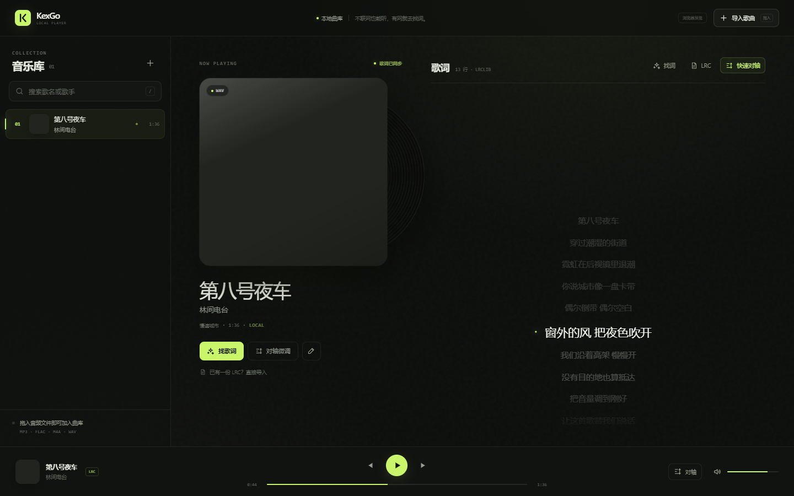
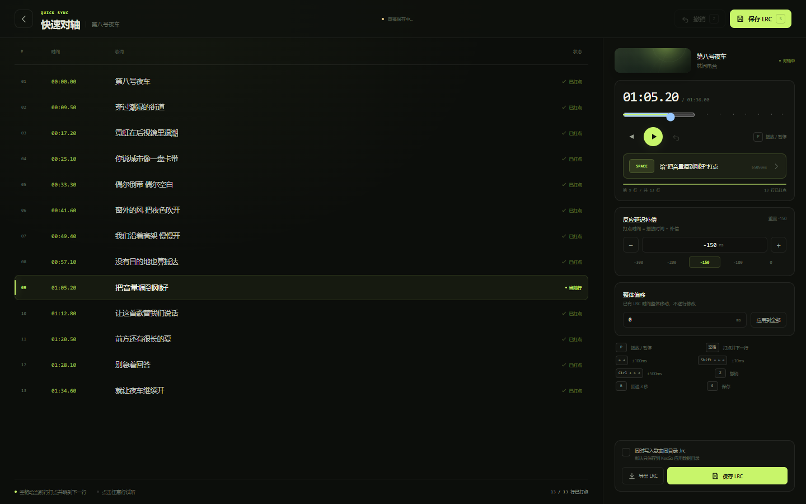

# KexGo

> 一个安静的本地音乐播放器。导入自己的歌，自动配好 LRC 与封面；没有歌词时，跟着唱一遍就能完成对轴。

KexGo 是一个 Tauri v2 + Vue 3 + TypeScript 的桌面音乐播放器。它不抓取任何音乐平台的音频，不做推荐、社交、评论或直播。产品的中心是「播放」，快速对轴只是内置的一把趁手工具。



## 已实现

- 拖拽 / 文件选择导入，支持多选；支持 MP3、FLAC、M4A、AAC、WAV、OGG、OPUS。
- 自动检测同名 `.lrc`（UTF-8 / UTF-16 / GB18030 兜底）和同目录 `cover.*`、同名图片；没有外部封面时读取音频内嵌封面。
- 封面复制到应用数据目录；音频本身只保存路径，不复制、不改标签。
- Rust 音频引擎：`rodio` + `symphonia` 解码，独立音频线程 + 250ms 进度事件，支持播放、暂停、拖动、音量、上一首 / 下一首。
- 歌词逐行高亮与平滑滚动；纯文本歌词可一键进入对轴。
- LRCLIB 开放歌词库查询；优先精确匹配，再列搜索结果；同步 LRC 和纯文本都支持。不包含任何平台音频爬虫。
- 跟打式快速对轴：空格打点、← / → 步进、Shift / Ctrl 精调、Z 撤销、R 回退 3 秒、S 保存。
- 反应延迟补偿（默认 `-150ms`）、全局整体偏移、每 700ms 自动保存草稿、重启恢复草稿。
- 保存到应用数据目录、可选同时写入歌曲同目录 `.lrc`、另存为 / 导出 LRC。
- 曲库 JSON 持久化，封面 / LRC / 草稿独立归档。
- 浏览器预览模式内置演示曲目，方便不启动 Tauri 时检查 UI。



## 快速启动

前置条件：Node.js ≥ 20、pnpm 10（`corepack enable` 会自动使用 `packageManager` 指定的版本）；桌面构建额外需要 Rust stable + MSVC Build Tools + WebView2。

```bash
pnpm install
pnpm dev          # 仅前端预览：http://127.0.0.1:1420/?demo=1
pnpm tauri dev    # 完整桌面应用
pnpm test         # LRC 解析 / 导出 / 清理 / 对轴辅助函数测试
pnpm build        # 前端类型检查 + 生产构建
pnpm test:ui      # 先启动 pnpm dev，再运行浏览器 UI 冒烟测试
pnpm tauri build  # 生成桌面安装包
```

> 本仓库在当前工作区完成了前端类型检查、单元测试、生产构建，以及 Rust 后端的 `cargo check` 与 `cargo clippy -D warnings`。当前构建容器没有 MSVC Build Tools，只用其 GNU 兼容工具链做了编译检查，因此未在本机生成 Windows 安装包；正式发行需在具备 MSVC + Rust stable + WebView2 的 Windows 机器上执行 `pnpm tauri build`。

## 项目结构

```
.
├── src/
│   ├── App.vue                     # 应用骨架、拖拽、启动
│   ├── api.ts                      # Tauri invoke 封装 + 浏览器预览 fallback
│   ├── stores/app.ts               # 播放器 / 曲库 / 找词 / 页面状态
│   ├── components/
│   │   ├── LibrarySidebar.vue      # 曲库列表
│   │   ├── NowPlaying.vue          # 封面、歌曲信息
│   │   ├── LyricsPane.vue          # 歌词滚动与找词入口
│   │   ├── PlayerBar.vue           # 播放控制
│   │   ├── AlignView.vue           # 快速对轴器
│   │   ├── LyricsSearchModal.vue   # LRCLIB 找词 / 粘贴歌词
│   │   ├── TrackEditModal.vue      # 信息与封面的轻量编辑
│   │   └── ...
│   └── utils/lrc.ts                # LRC 解析、导出、偏移、文本清理
├── src-tauri/
│   ├── src/audio.rs                # rodio 音频线程与播放状态
│   ├── src/commands.rs             # Tauri 命令
│   ├── src/library.rs              # JSON 曲库、导入、封面/LRC 管理
│   ├── src/lyrics.rs               # LRCLIB 查询
│   └── tauri.conf.json
├── docs/DESIGN.md                  # 完整设计说明（技术选型、流程、状态机、三周计划、文案）
├── scripts/make_demo_audio.py      # 原创演示音频生成
└── public/demo/                    # 浏览器预览用的示例曲目
```

## 数据与隐私

- 所有音乐、歌词、草稿都只在本机。
- 没有账号、埋点、遥测和在线音频下载。
- 找词只在用户进入曲目或主动点击找词时请求 `lrclib.net`；未发起任何平台爬虫或批量抓取。
- 原始音频文件永远只读，不做标签写入。

## 键盘速查（对轴器）

| 键 | 行为 |
| --- | --- |
| `P` | 播放 / 暂停 |
| `空格` | 给当前行打点，自动跳到下一行，不打断播放 |
| `← / →` | 当前行 ±100ms |
| `Shift + ← / →` | ±10ms |
| `Ctrl / Cmd + ← / →` | ±500ms |
| `Z` | 撤销上一次打点 / 微调 / 整体偏移 |
| `R` | 回退 3 秒 |
| `S` / `Ctrl + S` | 保存 LRC |
| `Esc` | 返回播放器（草稿已自动保存） |

## License

仅用于用户自己拥有或有权播放的本地音乐文件。代码以 MIT 许可发布。
